### Informasi Mahasiswa
**Nama**: Amalia Maharani Andessy

**NIM**: H1D024032

**Shift KRS**: E

**Shift WAR**: F

# Game Catalog App

Aplikasi Katalog dan Eksplorasi Video Game yang dibangun menggunakan **Kotlin** dan **Jetpack Compose**. Aplikasi ini mengambil dan menampilkan informasi video game dari REST API ([RAWG API](https://rawg.io/apidocs)) secara dinamis.

Aplikasi ini dibuat untuk memenuhi tugas responsi Praktikum Pemrograman Mobile.

---

## Screenshots

| Fitur / Halaman | Light Mode | Dark Mode |
| :--- | :---: | :---: |
| **Home Screen**<br/>Tampilan awal daftar game | 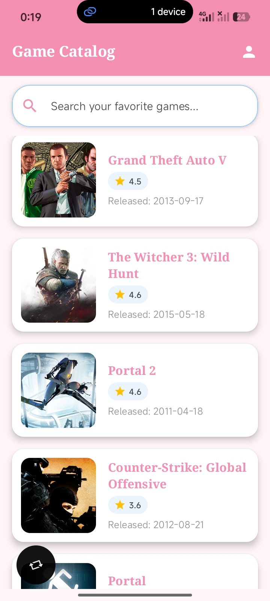 | 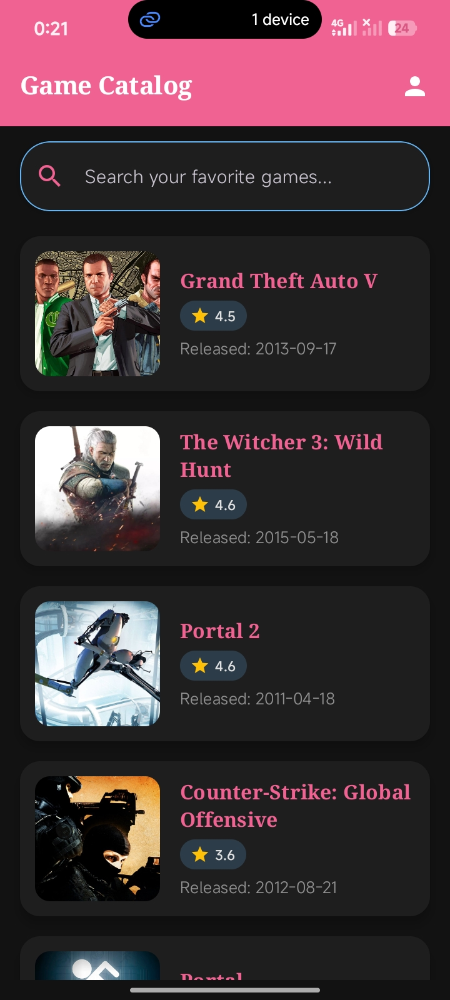 |
| **Detail Screen**<br/>Tampilan detail game | 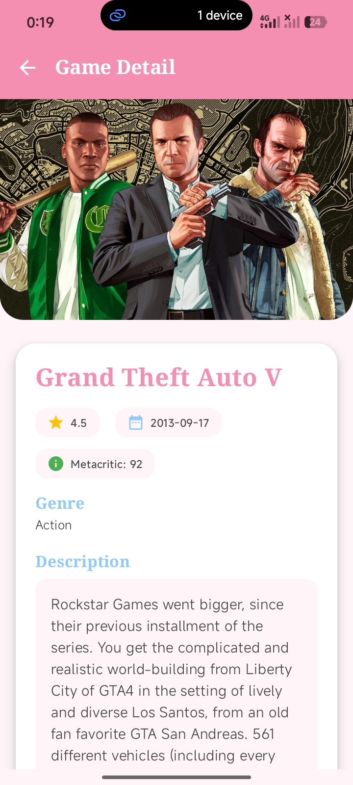 | 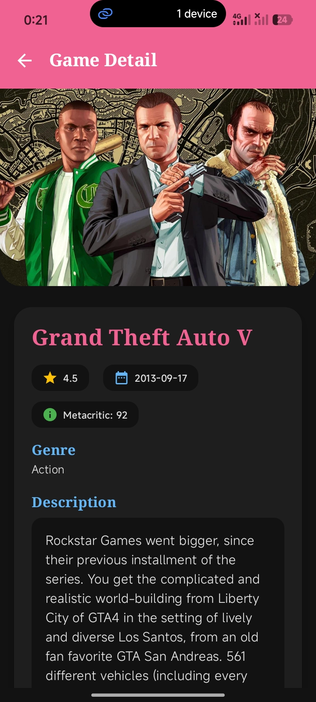 |
| **About Screen**<br/>Tampilan profil mahasiswa | 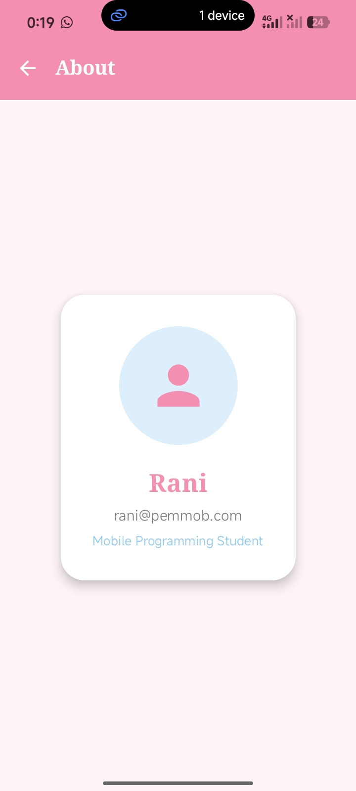 | 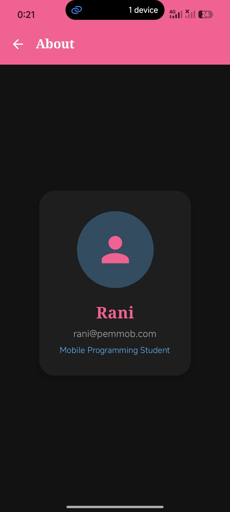 |
| **Active Search**<br/>Hasil pencarian game | 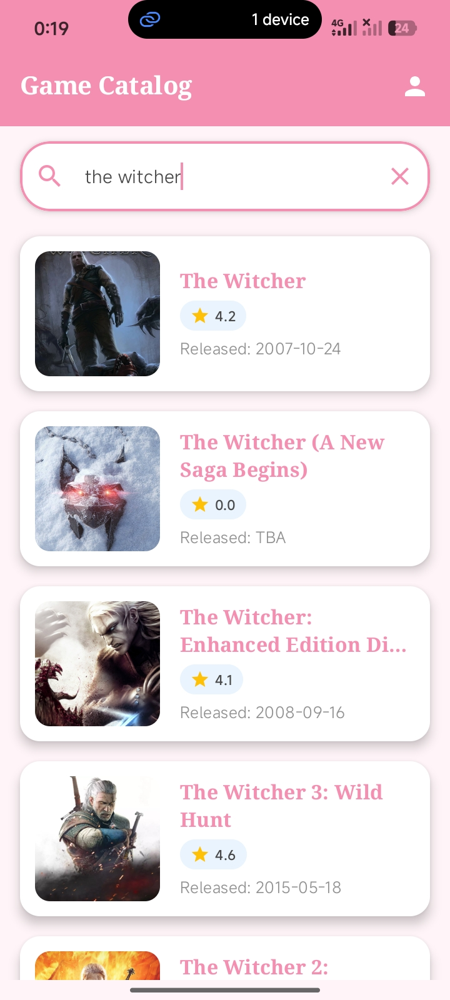 | 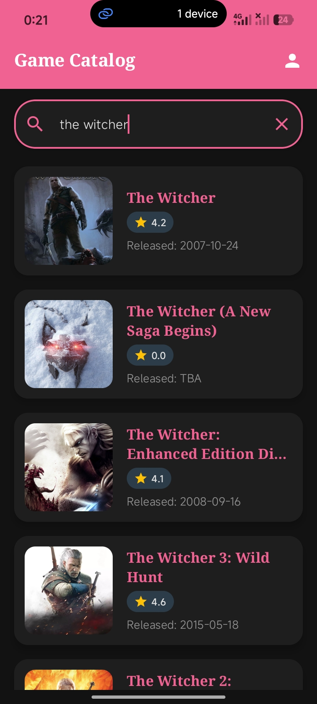 |
| **Empty Search**<br/>Game tidak ditemukan | 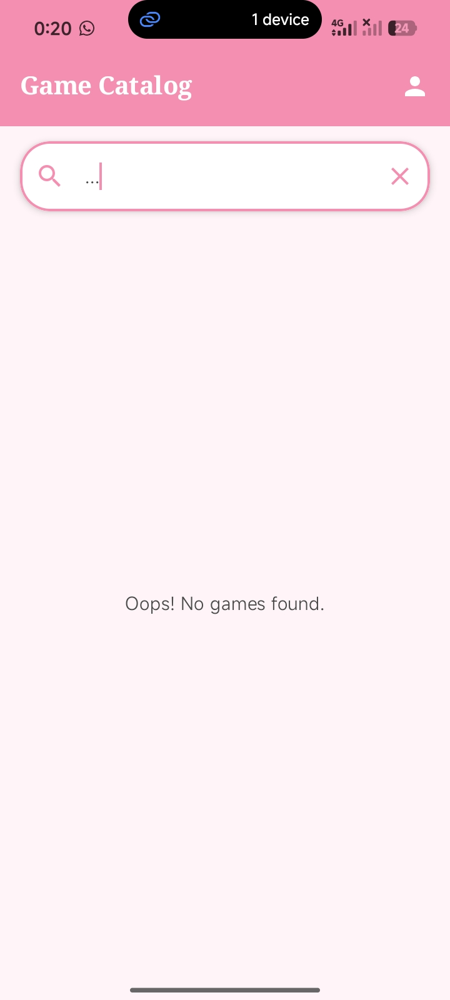 | 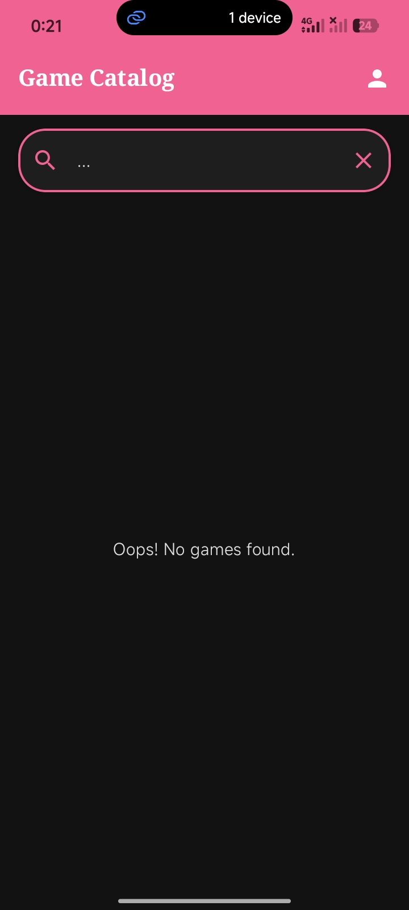 |
| **No Connection**<br/>Error saat internet mati | 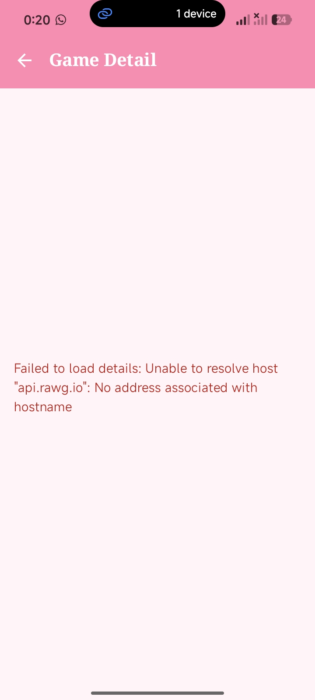 | 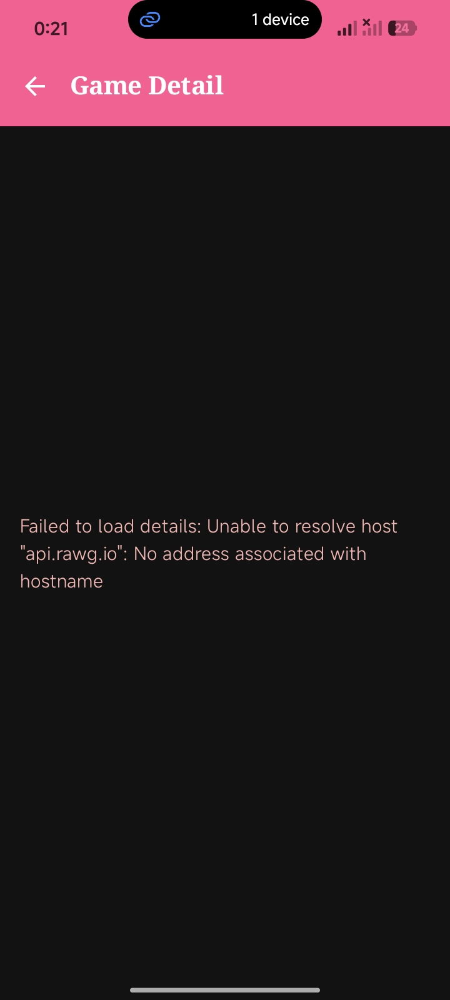 |

---

## Penjelasan Teknis

### 1. UI & Komponen (Jetpack Compose)
- **State-driven UI**: Memanfaatkan `StateFlow` dan proses *recomposition* untuk mengupdate tampilan secara dinamis saat data berubah (fase *Loading*, *Success*, dan *Error*).
- **Material Design 3**: Antarmuka dirancang menggunakan komponen M3 dengan kustomisasi tema warna bernuansa **Pastel (Pink & Biru)** serta tipografi elegan. Mendukung penuh **Light Mode** dan **Dark Mode**.
- **Lazy Layout**: Menggunakan `LazyColumn` untuk menampilkan daftar game secara efisien, sehingga *scrolling* tetap lancar (*smooth*) saat menampilkan data yang banyak.

### 2. Arsitektur (MVVM)
- Menerapkan arsitektur **Model-View-ViewModel (MVVM)** untuk memisahkan *business logic* dari UI (*View*).
- `GameViewModel` bertanggung jawab mengelola *state* dan memanggil *repository* (termasuk menerapkan *debounce* pada fitur pencarian).
- `GameRepository` bertindak sebagai penyedia data yang berkomunikasi dengan API.

### 3. Networking (Retrofit & RAWG API)
- Menggunakan pustaka **Retrofit** dan **Gson** untuk mengambil dan mem-parsing data dari JSON [RAWG API](https://rawg.io/docs/).
- Mendukung fungsionalitas **Pencarian (Search)** game yang *real-time*. Menangani *state* ketika data gagal dimuat (tidak ada koneksi) dan pencarian tidak membuahkan hasil.
- Data yang diekstrak dan ditampilkan: Nama Game, Rating, Tanggal Rilis, Gambar Background, Genre, Skor Metacritic, dan Deskripsi.

### 4. Navigasi & Fitur Tambahan
- **Image Loading**: Menggunakan pustaka *Coil* (`AsyncImage`) untuk memuat poster game secara *asynchronous* (dari URL jaringan).
- **Jetpack Navigation**: Menggunakan *Compose Navigation* untuk perutean dari halaman Home -> Detail -> About.

---

## Cara Menjalankan Project

1. Lakukan *Clone* pada repository ini.
2. Buka project menggunakan **Android Studio**.
3. Pastikan Anda memiliki API Key dari RAWG API.
4. Buka file `local.properties` (buat jika belum ada di *root* project), lalu tambahkan:
   ```properties
   RAWG_API_KEY="ISI_DENGAN_API_KEY_ANDA"
   ```
5. Klik *Sync Project with Gradle Files*.
6. Jalankan aplikasi (Run) pada *emulator* atau *physical device*.
